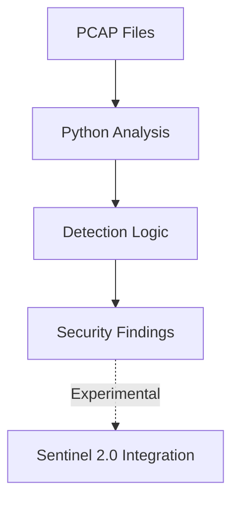

<!-- portfolio:start -->

# 🔬 Network Forensics Lab

### Python | Network Security | Packet Analysis

A Python-based cybersecurity laboratory focused
on offline packet analysis, network traffic
investigation, and experimental intrusion detection.

## Overview

This project explores how network traffic can be
examined to identify suspicious activity and support
security investigations.

## Technical Focus

- Offline packet capture (PCAP) analysis
- Suspicious network traffic investigation
- Python-based security analysis
- Experimental intrusion detection
- Security findings and reporting
- Integration experiments with Sentinel 2.0

## Architecture



## Technology Stack

| Technology | Purpose |
|---|---|
| Python | Analysis and automation |
| PCAP | Network traffic evidence |
| Linux / Termux | Development environment |
| Git | Version control |
| Sentinel 2.0 | Experimental dashboard integration |

## Development Roadmap

- [ ] Expand traffic detection rules
- [ ] Add structured JSON reporting
- [ ] Improve PCAP analysis workflows
- [ ] Add sample datasets
- [ ] Expand Sentinel integration
- [ ] Add automated tests
- [ ] Document investigation examples

## Security Research

This project is intended for defensive network
security research, education, and authorized testing.


## Getting Started

Clone the repository:

```bash
git clone https://github.com/cabralisjota/network-forensics-lab.git
cd network-forensics-lab
```

Install dependencies:

```bash
pip install -r requirements.txt
```

## Developer

**GitHub:** [@cabralisjota](https://github.com/cabralisjota)

**Interests:** Cybersecurity, Python, network
security, security automation, and IoT.

---

<!-- portfolio:end -->

## Additional Project Documentation

# Network Forensics Lab

A Python-based network forensics toolkit developed
using Android Termux and Scapy.

## Features

- PCAP file analysis
- TCP and UDP packet inspection
- TCP conversation identification
- HTTP request and response extraction
- Basic TCP stream reassembly
- Time-based port scan detection
- JSON forensic report generation
- Incident investigation documentation

## Technologies

- Python
- Scapy
- TCP/IP
- HTTP
- JSON
- Android Termux

## Usage

Install dependencies:

pip install -r requirements.txt

Analyze an HTTP capture:

python forensic_report.py http.cap

Detect simulated port scanning:

python timed_detector.py

Extract HTTP messages:

python extract_http.py

## Investigations

### NF-001: Possible TCP Port Scan

Simulated network reconnaissance involving
10 destination ports probed within 9 seconds.

### NF-002: HTTP Traffic Investigation

Analysis of a recorded Wireshark sample capture.

Findings:
- 43 packets
- 41 TCP packets
- 2 TCP conversations
- 5 detected HTTP message starts

## Limitations

- Port scan detection uses a basic threshold.
- TCP reassembly is educational, not production-grade.
- HTTP extraction does not fully reassemble streams.
- Training captures do not demonstrate real compromise.

## Ethical Use

This project is intended for cybersecurity education,
authorized network analysis, and incident response training.

## Intrusion Detection System (IDS v1.0)

This project includes a Python-based, offline
network intrusion detection engine using Scapy.

### Detection Rules

| Rule | Severity | Detection |
|------|----------|-----------|
| TCP_PORT_SCAN | Medium | 5 unique destination ports in 60 seconds |
| TCP_NULL_SCAN | Medium | TCP packet with no flags set |
| TCP_SYN_BURST | High | 100 initial SYN packets in 60 seconds |

### Usage

Run the IDS against a PCAP file:

    python ids_engine.py timed_traffic.pcap

Test normal HTTP traffic:

    python ids_engine.py http.cap

Generate synthetic test traffic:

    python create_ids_tests.py

Run the automated regression tests:

    python test_ids.py

### Results

The initial automated test suite passed 3/3 tests:

- Port scan detected in simulated traffic.
- No alerts in the recorded HTTP sample.
- NULL-flag and SYN-burst patterns detected.

### Limitations

- Offline PCAP analysis only.
- Rule-based detection can produce false positives.
- Detection thresholds are experimental.
- Packets are assumed to be time-ordered.
- Alerts are deduplicated per rule and endpoint pair.
- SYN retransmissions are not separately identified.
- No full TCP session-state tracking.

### Ethical Use

Use only on owned, authorized, or synthetic
network captures.

## Intrusion Detection System (IDS v1.0)

Offline network intrusion detection using Python and Scapy.

### Detection Rules

| Rule | Severity | Threshold |
|------|----------|-----------|
| TCP_PORT_SCAN | Medium | 5 unique ports in 60 seconds |
| TCP_NULL_SCAN | Medium | TCP packet with no flags |
| TCP_SYN_BURST | High | 100 SYN packets in 60 seconds |

### Run the IDS

    python ids_engine.py timed_traffic.pcap

### Run Automated Tests

    python test_ids.py

### Test Results

All three regression tests passed (3/3).

### Limitations

- Offline PCAP analysis only
- Experimental detection thresholds
- Potential false positives
- No full TCP session tracking
- Requires locally available test captures

## IDS Engine v2.0

Offline, rule-based intrusion detection using
Python and Scapy.

### Detection Capabilities

- TCP port scan detection
- TCP NULL flag detection
- TCP FIN-only flag detection
- TCP Xmas flag detection
- TCP SYN burst detection
- Timestamp-ordered packet analysis
- JSON security alerts
- Markdown incident reporting

### Run

    python ids_engine.py timed_traffic.pcap

Generate a report:

    python ids_report.py

Run the self-contained tests:

    python test_ids.py

### Testing

Seven synthetic test scenarios cover five
detection rules, normal traffic, and
out-of-order packet timestamps.

### Limitations

This is an educational offline IDS.
Detection rules identify suspicious patterns,
not confirmed attacks. Thresholds require
validation before operational use.
